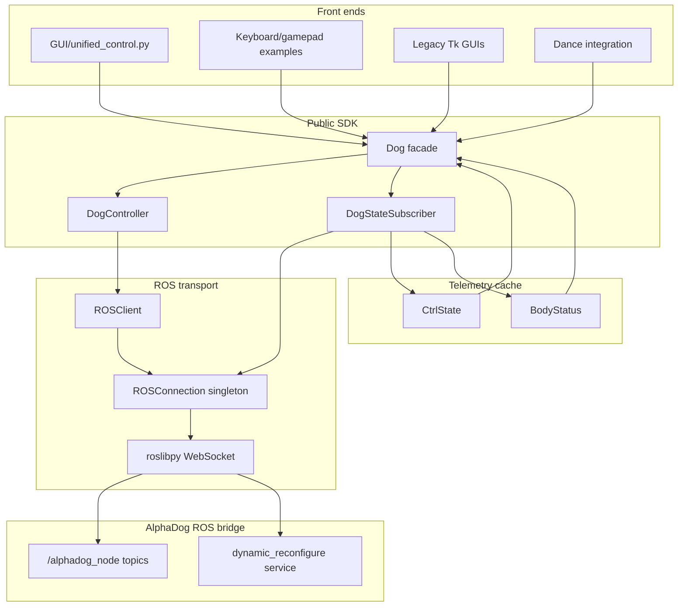

# RoboDog Architecture and Code Review

Review date: 2026-10-27  
Reviewed commit: `951a60b`  
Scope: `robodog/`, `GUI/`, `examples/`, `dance/`, packaging, installers, CI, and documentation.

> This document is a technical review and issue register. It does not change runtime behavior.

## Executive summary

RoboDog has a useful basic architecture: a public `Dog` facade isolates callers from ROS, while GUI and examples consume that facade. The implementation is not yet robot-safety or production ready.

Highest-risk themes:

1. The robot control channel is plaintext and unauthenticated.
2. Emergency stop is duplicated, blocking, unbounded, and can silently fail.
3. Every parameter write re-sends all defaults and can clobber robot settings.
4. Validation is split across layers; several safety-critical parameters are unchecked.
5. A process-wide ROS connection singleton causes multiple `Dog` instances to interfere.
6. Frontends duplicate control and safety logic instead of sharing one control core.
7. The advertised GUI dance feature crashes before starting.
8. Existing tests can report failure while pytest still marks them as passed.

The repository currently has no voice-agent implementation. Voice support should be added only after safety and control-core issues are fixed.

## Current architecture



### Runtime flow

1. `Dog(host, port)` creates an `ROSClient`.
2. `ROSClient` mutates the process-wide `ROSConnection` singleton.
3. `Dog.connect()` creates the ROS connection and subscribes to control/body topics.
4. Property writes call `Dog.set_parameters()`.
5. `DogController` merges the request with every `DEFAULT_PARAMS` value.
6. A blocking `dynamic_reconfigure/Reconfigure` service call sends the full parameter set.
7. Subscriber callbacks mutate telemetry objects from the ROS I/O thread.
8. GUI workers can issue commands concurrently with Tk callbacks and ROS callbacks.

## Issue register

| ID | Severity | Issue | Primary files |
|---|---|---|---|
| [RI-01](#ri-01-critical--secure-the-ros-control-channel) | Critical | Secure the ROS control channel | `robodog/connection.py`, `robodog/client.py` |
| [RI-02](#ri-02-critical--make-emergency-stop-dependable) | Critical | Make emergency stop dependable | `GUI/`, `examples/`, `robodog/client.py` |
| [RI-03](#ri-03-high--send-only-changed-parameters) | High | Send only changed parameters | `robodog/controller.py` |
| [RI-04](#ri-04-high--unify-parameter-schema-typing-and-validation) | High | Unify parameter schema, typing, and validation | `robodog/config.py`, `robodog/dog.py`, `robodog/controller.py` |
| [RI-05](#ri-05-high--replace-the-global-rosconnection-singleton) | High | Replace the global `ROSConnection` singleton | `robodog/connection.py`, `robodog/client.py` |
| [RI-06](#ri-06-high--separate-commanded-state-from-telemetry) | High | Separate commanded state from telemetry | `robodog/dog.py`, `robodog/states.py` |
| [RI-07](#ri-07-high--fix-unsafe-demo-and-broken-gui-dance) | High | Fix unsafe demo and broken GUI dance | `examples/demo_basic_movement.py`, `GUI/unified_control.py` |
| [RI-08](#ri-08-high--harden-release-and-installer-supply-chain) | High | Harden release and installer supply chain | `.github/workflows/`, `install.sh`, `install.bat` |
| [RI-09](#ri-09-medium--consolidate-duplicated-frontends-and-configuration) | Medium | Consolidate duplicated frontends and configuration | `GUI/`, `examples/` |
| [RI-10](#ri-10-medium--add-real-tests-and-align-packagingdocs) | Medium | Add real tests and align packaging/docs | `pyproject.toml`, `README.md`, future `tests/` |
| [RI-11](#ri-11-enhancement--add-an-offline-first-safety-gated-voice-agent) | Enhancement | Add an offline-first, safety-gated voice agent | future `robodog/voice/` |

## Detailed findings and issue drafts

### RI-01: Critical — Secure the ROS control channel

**Problem.** Robot control uses a plaintext, unauthenticated rosbridge WebSocket.

**Evidence.**

- `robodog/connection.py:25` constructs `roslibpy.Ros(host, port)` without TLS or authentication.
- No `is_secure`, WSS, certificate, or authentication option is exposed.
- Default endpoint: `10.10.10.10:9090` in `robodog/dog.py:67`.
- `vx` accepts up to `±4.0 m/s` in `robodog/dog.py:13`.
- `collision_protect` is remotely configurable in `robodog/config.py:31`.

**Risk.** Any device able to reach the robot's ROS bridge port can issue motion commands, change gait, trigger actions, or disable collision protection.

**Recommended change.** Expose TLS/certificate/authentication options; prefer WSS; require explicit opt-in for plaintext connections outside documented private robot networks; document the network trust boundary.

**Acceptance criteria.** Secure transport is configurable; plaintext use is explicit and visibly warned; README documents the threat model; tests cover configuration without hardware.

### RI-02: Critical — Make emergency stop dependable

**Problem.** Emergency stop is duplicated and implemented as several blocking property writes whose failures can be hidden.

**Evidence.**

- GUI stop: `GUI/unified_control.py:753-763`.
- Similar code: `examples/robodog_gui.py:360-369`, `examples/gamepad_control.py:96-102`, `examples/improved_keyboard_control.py:200-205`.
- No service timeout: `robodog/client.py:44-47`.
- Exceptions become ignored `False` values: `robodog/controller.py:63-64`.

**Risk.** If Wi-Fi or rosbridge stalls, emergency stop can block indefinitely or silently fail while the UI reports success.

**Recommended change.** Add one library-level `Dog.stop(timeout=...)` that batches `vx`, `vy`, and `wz`, reports failure, and uses hardware E-stop if available.

**Acceptance criteria.** One shared stop implementation; explicit timeout; visible failure; tests for success, timeout, and service failure.

### RI-03: High — Send only changed parameters

**Problem.** Every parameter write sends the complete default parameter set.

**Evidence.**

- `robodog/controller.py:52-53` copies `DEFAULT_PARAMS` and overlays requested values.
- A one-parameter write produces a 31-parameter request.
- `GUI/unified_control.py:800-811` can issue four separate full writes per tick.

**Risk.** A velocity write can reset friction, gait, user mode, collision settings, or other values changed through another client; full requests also add latency.

**Recommended change.** Send only changed keys and batch motion updates.

**Acceptance criteria.** One-key updates produce one-key requests; previous non-default settings are preserved; GUI movement updates are batched; tests assert request contents.

### RI-04: High — Unify parameter schema, typing, and validation

**Problem.** Names, defaults, ranges, types, properties, request construction, and documentation are separate and have drifted.

**Evidence.**

- Defaults: `robodog/config.py:9-47`.
- Ranges: `robodog/dog.py:10-40`.
- Validation: `robodog/dog.py:123-130`.
- Request typing: `robodog/controller.py:72-76`.
- Documentation: `README.md:113-133`.

`collision_protect`, `controller_type`, `gait`, `free_leg`, `ground_model`, and `action_*` lack effective range validation. `vx = 0` is placed in `config.ints` even though `vx` is a double parameter.

**Recommended change.** Create one parameter schema containing name, default, minimum, maximum, dtype, and telemetry mapping; derive defaults, validation, properties, request typing, and docs.

**Acceptance criteria.** Unknown/out-of-range values fail before transport; double parameters remain doubles; integer safety parameters have ranges; docs are generated or checked from schema.

### RI-05: High — Replace the global `ROSConnection` singleton

**Problem.** Multiple `Dog` instances share and mutate one global ROS connection.

**Evidence.**

- Singleton: `robodog/connection.py:5-13`.
- Shared host mutation: `robodog/client.py:8-10`.
- Dead-client `connect()` no-op: `robodog/connection.py:23-26`.
- Conditional cleanup: `robodog/connection.py:28-32`.

A fake-transport check confirmed that connecting `Dog(A)` and then `Dog(B)` leaves both instances pointed at B.

**Recommended change.** Give each `ROSClient` an owned connection, or strictly guard a singleton with host-change rejection, locking, and reference counting. Add public reconnect support.

**Acceptance criteria.** Instances cannot redirect or disconnect each other; dead clients recover; reconnect behavior is tested.

### RI-06: High — Separate commanded state from telemetry

**Problem.** Writable parameter getters read telemetry fields. Many settable parameters have no telemetry field, so getters raise `AttributeError`.

**Evidence.**

- Getter: `robodog/dog.py:51-54`.
- Telemetry fields: `robodog/states.py:43-59`.
- `body_height` maps to measured `z`: `robodog/dog.py:138`.
- `foot_height`, `friction`, and `collision_protect` have no telemetry backing field.

**Recommended change.** Separate telemetry properties from commanded-state properties; cache commanded values or make command properties write-only; expose per-stream freshness.

**Acceptance criteria.** Every documented read is meaningful or explicitly write-only; commanded and measured state are distinct; stale telemetry is visible; tests cover all properties.

### RI-07: High — Fix unsafe demo and broken GUI dance

**Problem.** The unified GUI dance action crashes, and the basic movement demo can drive at high speed for roughly 50 minutes.

**Evidence.**

- Undefined `self.control_active`: `GUI/unified_control.py:1003`.
- Unsafe loop: `examples/demo_basic_movement.py:35-44`.

**Recommended change.** Use the actual `running` state; restore the demo's short speed sequence and use its loop variable; route dance UI updates through the Tk main thread.

**Acceptance criteria.** Dance starts/stops with a fake `Dog`; the demo duration is short and documented; regression tests catch control-state errors.

### RI-08: High — Harden release and installer supply chain

**Problem.** Release and installation paths have avoidable supply-chain risks.

**Evidence.**

- PyPI publish on every push: `.github/workflows/PyPi-publish.yml:6`.
- Three matrix jobs publish identical artifacts.
- A long-lived PyPI token is used.
- No tests run before publication.
- `install.sh:73` pipes remote code to shell; `install.sh:107` clears `.venv`.
- `install.bat:22` bypasses PowerShell execution policy.

**Recommended change.** Publish only from tags/releases; run tests before one publish job; use trusted publishing/OIDC; pin/checksum installers; prompt before rc edits or `.venv` deletion.

**Acceptance criteria.** Feature pushes cannot publish; publication requires passing tests; no long-lived PyPI token; installer downloads are verified and destructive actions confirmed.

### RI-09: Medium — Consolidate duplicated frontends and configuration

**Problem.** Movement mappings, levels, gamepad conversion, connection lifecycle, reset, stop, and control loops are duplicated across frontends.

**Evidence.**

- Unified GUI maps: `GUI/unified_control.py:23-89`.
- Similar logic in `examples/robodog_gui.py`, `examples/gamepad_control_gui.py`, `examples/gamepad_control.py`, `examples/keyboard_control.py`, and `examples/improved_keyboard_control.py`.
- `GUI/config_example.ini` is documented but never parsed.
- Default height is inconsistently `0.23` or `0.25` across paths.

**Recommended change.** Create a shared control core for mappings, movement calculation, session lifecycle, stop, reset, and defaults. Implement config loading or remove dead config/docs.

**Acceptance criteria.** One source owns mappings/defaults/safety actions; frontends import shared logic; config has observable behavior or is removed.

### RI-10: Medium — Add real tests and align packaging/docs

**Problem.** Existing checks can fail without failing pytest; package metadata, exports, README, and Python-version support drift.

**Evidence.**

- Tests return booleans instead of asserting.
- The GUI integration test can print `No module named 'tkinter'` and still pass.
- `examples/test.py` is a hardware demo, not an automated test.
- Package version `0.1.2.5`: `pyproject.toml:7`; runtime version `0.1.0`: `robodog/__init__.py:8`.
- Undefined `DogState` is exported: `robodog/__init__.py:9`.
- Python 3.11 compilation fails in `examples/demo_advanced_movement.py` and `examples/test.py`.
- README documents ranges and APIs that differ from code.

**Recommended change.** Add a real `tests/` suite using fake ROS/`Dog`; rename hardware demos as manual examples; align versions and syntax; generate/check README tables.

**Acceptance criteria.** CI runs assertions on Python 3.10-3.12; failing checks fail tests; star import succeeds; versions agree; all examples compile on supported versions.

### RI-11: Enhancement — Add an offline-first, safety-gated voice agent

**Problem.** There is no voice-agent implementation. Adding one now would inherit unsafe command failure, validation gaps, connection races, and duplicated frontend logic.

**Recommended architecture.**

```text
microphone
  -> VAD
  -> optional wake word
  -> local-first STT
  -> deterministic command router
       -> direct safety commands
       -> motion and dance intents
       -> optional LLM conversation
  -> safety policy
  -> serialized Dog command queue
  -> public Dog API
```

**Design constraints.**

- `stop` works offline and bypasses the LLM.
- LLM actions pass through the same schema and safety policy as deterministic commands.
- Voice code never publishes raw ROS topics.
- Barge-in cancels speech and motion.
- GUI, gamepad, and voice share one command queue.
- Routing and safety behavior are testable with `FakeDog`.

**Acceptance criteria.** Offline commands cover stop, movement, modes, and dance; risky actions require confirmation; stale telemetry/E-stop blocks commands; docs cover latency, privacy, offline behavior, and network trust.

## DRY analysis

DRY violations are producing safety drift, not merely maintenance overhead.

### Parameter definitions are repeated

| Responsibility | Current location |
|---|---|
| Names and defaults | `robodog/config.py` |
| Ranges | `robodog/dog.py` |
| Public properties | `robodog/dog.py` |
| Request typing | `robodog/controller.py` |
| Documentation | `README.md` |

These sources already disagree:

| Parameter | README | Code |
|---|---:|---:|
| `vx` | ±1.0 | ±4.0 |
| `wz` | ±1.0 | ±2.0 |
| `roll`/`pitch`/`yaw` | ±0.5 | ±1.0 |
| `body_height` | 0.1-0.35 | 0.09-0.35 |
| `foot_height` | 0-0.15 | 0.01-0.26 |

### Frontend control logic is repeated

A normalized scan of 11 control/demo files found 81 shared eight-line code windows.

| Duplicated unit | Locations |
|---|---|
| Velocity update and delta threshold | Unified GUI, legacy GUI, gamepad GUI, keyboard controller |
| WASD/QE movement map | Unified GUI, legacy GUI, keyboard controllers |
| Speed and height levels | Four frontends plus `config_example.ini` |
| Xbox button map | Unified GUI, gamepad GUI, CLI gamepad |
| Gamepad dead-zone and axis conversion | Three implementations |
| Emergency stop | At least four implementations |
| Reset posture | Five implementations |
| Default posture dictionary | Five example/control files |
| Connect/disconnect lifecycle | Three GUI implementations |
| Hardcoded `192.168.118.29` | GUI, config, five examples, docs |
| Neutral dance pose | Repeated through `dance/core/simple_actions.py` |

### DRY remediation

1. Create `robodog/parameters.py` with one `ParamSpec` table.
2. Derive defaults, ranges, validation, request typing, properties, and docs from it.
3. Create `robodog/control.py` for mappings, movement calculation, session lifecycle, stop, and reset.
4. Consolidate frontends around that core.
5. Implement configuration loading or remove the dead config.
6. Consolidate version, host, Python-version, and default-height constants.

## Voice-agent patterns from comparable systems

| Product/project | Useful pattern | Application to RoboDog |
|---|---|---|
| [Unitree Go2](https://www.unitree.com/en/go2) and [VuiClient](https://support.unitree.com/home/en/G1_developer/VuiClient_Service) | Offline voice interaction and commands | Deterministic local intents for stop, movement, modes, dances |
| [Home Assistant Assist pipelines](https://developers.home-assistant.io/docs/voice/pipelines/) | Explicit wake-word, STT, intent, and TTS stages | Replaceable voice pipeline stages with offline fallback |
| [Home Assistant wake words](https://www.home-assistant.io/voice_control/about_wake_word/) | Wake-word detection isolated from intent handling | Optional, configurable wake word |
| [Pipecat interruptions](https://docs.pipecat.ai/pipecat/fundamentals/interruptions) | Barge-in cancels in-flight output | Cancel speech and robot motion on `stop` |
| [NASA JPL ROSA](https://github.com/nasa-jpl/rosa) | Robot capabilities exposed as typed tools | Voice/LLM calls public `Dog` API only |
| [RobotecAI RAI](https://github.com/RobotecAI/rai) | ROS isolated behind configurable toolsets | Generate voice tools from the parameter schema |
| [Gemini Robotics](https://ai.google.dev/gemini-api/docs/robotics-overview) | Layered safety for physical robots | Safety policy before every voice action |
| [Hugging Face speech-to-speech](https://github.com/huggingface/speech-to-speech) | Pluggable VAD, ASR, LLM, and TTS stages | Measure per-stage latency; support local/cloud stages |
| [Go2 voice-control prototype](https://github.com/007zsr/unitree-GO2-voice-control) | Mock-first development and safety queueing | `FakeDog` tests before hardware integration |

## Recommended remediation order

### P0 — Safety and correctness

1. Implement one partial, timeout-bound `Dog.stop()` and use it everywhere.
2. Stop merging `DEFAULT_PARAMS` into every request.
3. Build a single parameter schema with dtype and range validation.
4. Replace or strictly guard the connection singleton.
5. Fix `control_active` in the dance GUI.
6. Fix `demo_basic_movement.py`.
7. Restrict PyPI publishing to tested releases.

### P1 — Architecture and DRY

1. Extract shared control constants and movement/session helpers.
2. Batch velocity/posture updates.
3. Route all Tk updates through the GUI thread.
4. Fix telemetry versus commanded-state semantics.
5. Implement config loading or remove the dead config.
6. Consolidate duplicate GUI implementations.
7. Generate parameter documentation from schema.

### P2 — Test and voice foundation

1. Add `tests/` with fake ROS transport and `FakeDog`.
2. Test validation, request typing, stop failure, reconnect, dance cancellation, and GUI logic.
3. Rename hardware demos so pytest does not treat them as unit tests.
4. Add CI for Python 3.10, 3.11, and 3.12.
5. Add `robodog/voice/` only after the safety core and shared command queue exist.

## Verification performed

- Python 3.14 full-source compilation: passed.
- Python 3.11 compilation: failed in `examples/demo_advanced_movement.py:22` and `examples/test.py:13`.
- Existing pytest collection: `3 passed`, with three `PytestReturnNotNoneWarning` warnings.
- The GUI integration test printed `No module named 'tkinter'` and returned `False`, but pytest still counted it as passed.
- Stubbed ROS verification confirmed:
  - Singleton cross-wiring between two `Dog` instances.
  - `collision_protect=0` and `gait=999` accepted.
  - Thirty-one parameters sent for a one-parameter update.
  - `vx=0` misclassified as an integer parameter.
  - `foot_height`, `friction`, and `collision_protect` getters raise `AttributeError`.
  - `from robodog import *` fails because `DogState` is undefined.

No hardware or live robot network was contacted.
